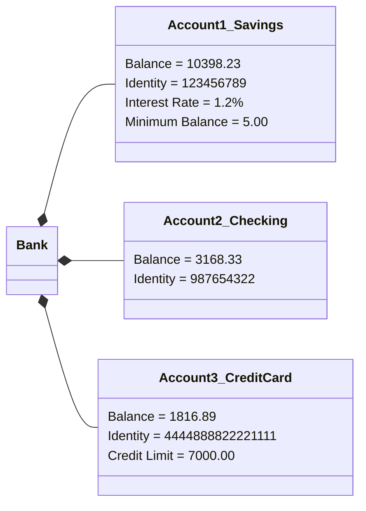

# Manual Teórico-Práctico: Fundamentos de Desarrollo Web y Programación Orientada a Objetos

Este documento constituye el material de referencia completo para la formación académica en ingeniería de software. Abarca desde la estructuración de documentos HTML5 e integración de estilos CSS internos, pasando por el análisis de la evolución paradigmática de la programación (Crisis del Software y niveles de abstracción), hasta el diseño exhaustivo de sistemas mediante la Programación Orientada a Objetos (POO) y su modelado en lenguaje UML.

---

## 1. Estructura Base y Semántica en HTML5 con CSS Embebido

El lenguaje HTML5 establece la arquitectura estructural de una aplicación web mediante componentes semánticos que aportan significado explícito tanto a navegadores como a motores de búsqueda y tecnologías de accesibilidad. A continuación, se presenta una plantilla base totalmente comentada que integra hojas de estilo en cascada (CSS) dentro de la cabecera del documento.

```html
<!DOCTYPE html>
<!-- Indica al navegador que el documento responde al estándar HTML5 -->
<html lang="es">
<head>
    <!-- Define la codificación de caracteres UTF-8 para soporte de tildes y caracteres especiales -->
    <meta charset="UTF-8">
    <!-- Configura la ventana gráfica (viewport) para garantizar la adaptabilidad en dispositivos móviles -->
    <meta name="viewport" content="width=device-width, initial-scale=1.0">
    <!-- Título de la pestaña del navegador -->
    <title>Estructura Base HTML5 y CSS</title>
    
    <!-- HOJA DE ESTILOS CSS EMBEBIDA -->
    <style>
        /* Reset global para estandarizar márgenes y cálculo de dimensiones */
        * {
            margin: 0;
            padding: 0;
            box-sizing: border-box;
        }

        /* Configuración tipográfica y de color del cuerpo del documento */
        body {
            font-family: Arial, Helvetica, sans-serif;
            line-height: 1.6;
            color: #333333;
            background-color: #f4f4f9;
        }

        /* Estilos del contenedor del encabezado principal */
        header {
            background-color: #1a365d;
            color: #ffffff;
            padding: 1.5rem;
            text-align: center;
        }

        /* Estilos del menú de navegación y sus hipervínculos */
        nav {
            background-color: #2b6cb0;
            display: flex;
            justify-content: center;
        }

        nav a {
            color: #ffffff;
            text-decoration: none;
            padding: 0.75rem 1.25rem;
            display: inline-block;
        }

        nav a:hover {
            background-color: #2c5282;
        }

        /* Contenedor principal con limitación de ancho y centrado automático */
        .container {
            max-width: 900px;
            margin: 2rem auto;
            padding: 0 1rem;
        }

        /* Estilos para bloques de contenido independientes */
        article {
            background-color: #ffffff;
            padding: 1.5rem;
            margin-bottom: 1.5rem;
            border-radius: 8px;
            border: 1px solid #e2e8f0;
        }

        h1, h2 {
            margin-bottom: 0.75rem;
        }

        /* Estilos para el pie de página institucional */
        footer {
            background-color: #1a365d;
            color: #ffffff;
            text-align: center;
            padding: 1rem;
            margin-top: 2rem;
        }
    </style>
</head>
<body>

    <!-- ENCABEZADO PRINCIPAL DE LA PÁGINA -->
    <header>
        <h1>Mi Sitio Web Estructurado</h1>
        <p>Demostración de estructura semántica en HTML5 y CSS interno</p>
    </header>

    <!-- BARRA DE NAVEGACIÓN PRINCIPAL -->
    <nav>
        <a href="#inicio">Inicio</a>
        <a href="#acerca">Acerca de</a>
        <a href="#contacto">Contacto</a>
    </nav>

    <!-- CONTENIDO PRINCIPAL (MAIN) -->
    <main class="container">
        <!-- ARTÍCULO 1: SECCIÓN DE BIENVENIDA -->
        <article id="inicio">
            <h2>Bienvenido a la Web</h2>
            <p>Esta plantilla demuestra la utilización de HTML5 semántico para delimitar áreas de contenido.</p>
        </article>

        <!-- ARTÍCULO 2: DETALLES ARQUITECTÓNICOS -->
        <article id="acerca">
            <h2>Sobre la Estructura</h2>
            <p>El uso correcto de etiquetas semánticas optimiza el posicionamiento SEO y facilita la accesibilidad universal.</p>
        </article>
    </main>

    <!-- PIE DE PÁGINA -->
    <footer>
        <p>&copy; 2026 - Todos los derechos reservados.</p>
    </footer>

</body>
</html>
```

---

## 2. Contexto Histórico: La Crisis del Software

A finales de la década de 1960, la industria de la computación experimentó una dramática evolución en el poder de procesamiento del hardware. La reducción de costos y el aumento de velocidad permitieron encarar proyectos informáticos de una escala inédita. Sin embargo, la ausencia de metodologías rigurosas y de lenguajes de programación con abstracción adecuada desencadenó la denominada **Crisis del Software** (término acuñado en la Conferencia de la NATO de 1968 en Garmisch, Alemania).

### Factores e Impactos de la Crisis
* **Incertidumbre Presupuestaria:** Proyectos que sobrepasaban ampliamente las estimaciones financieras y de tiempo.
* **Código Inmantenible:** Construcción de programas basados en lógica difusa y saltos incondicionales (*código spaghetti*).
* **Fragilidad e Infiabilidad:** Presencia masiva de errores (*bugs*) en entornos de producción y dificultad extrema para incorporar nuevas funcionalidades sin romper partes existentes.

Como señaló Edsger Dijkstra en su conferencia del Premio Turing (1972):
> *"La causa principal de la crisis del software es que las máquinas se han vuelto varios órdenes de magnitud más potentes. Mientras no teníamos computadoras, la programación no era un problema; cuando tuvimos computadoras lentas, la programación se convirtió en un problema menor; ahora que tenemos gigantescas computadoras, la programación se ha convertido en un problema igualmente gigantesco."*

---

## 3. Clasificación y Niveles de Lenguajes de Programación

Para mitigar la complejidad en el desarrollo, los lenguajes de programación evolucionaron elevando su nivel de abstracción con respecto al hardware subyacente.

| Nivel de Abstracción | Características Principales | Ejemplos |
| :--- | :--- | :--- |
| **Bajo Nivel** | Instrucciones binarias directas (Lenguaje Máquina) o códigos mnemónicos vinculados a la arquitectura de la CPU (Ensamblador). Máximo rendimiento con nula portabilidad. | Assembly (x86, ARM), Código Máquina |
| **Medio Nivel** | Combina estructuras de control de alto nivel con manipulación directa de punteros y memoria física. | C, C++ |
| **Alto Nivel** | Representación orientada al dominio del problema o al lenguaje humano. Oculta la gestión de memoria y detalles de la máquina de estados mediante compiladores o máquinas virtuales. | Java, Python, C#, JavaScript, PHP |

### Modelos de Ejecución
* **Lenguajes Compilados:** El código fuente se traduce íntegramente a código máquina binario ejecutable previo a la fase de ejecución (ej. C, Rust, Go).
* **Lenguajes Interpretados:** Un programa intérprete analiza y ejecuta las instrucciones línea por línea en tiempo real (ej. Python, Ruby).
* **Modelos Híbridos (Bytecode):** El código fuente se compila a un código intermedio ejecutable sobre una Máquina Virtual (ej. Java con la JVM, C# con CLR).

---

## 4. Transición Paradigmática: De la Programación Estructurada a la POO

### Programación Estructurada
Basada en el teorema de Jacopini y Böhm, sostiene que todo algoritmo puede expresarse mediante tres estructuras fundamentales: **secuencia, selección e iteración**. Su enfoque metodológico promueve la descomposición modular a través de funciones y procedimientos.

> **Deficiencia operativa:** La programación estructurada mantiene una separación tajante entre los datos (estructuras/variables) y las funciones que operan sobre ellos. Si la estructura interna de los datos sufre variaciones, todas las funciones que consumen dicha estructura deben ser modificadas, incrementando el riesgo de fallos en proyectos de gran escala.

### Programación Orientada a Objetos (POO)
La POO resuelve esta ruptura unificando los datos y las operaciones que actúan sobre ellos dentro de una misma entidad computacional denominada **Objeto**.

#### Pilares de la POO
1. **Encapsulamiento:** Oculta el estado interno del objeto y solo permite su modificación mediante métodos expuestos explícitamente (interfaz pública).
2. **Abstracción:** Identifica y extrae las características esenciales de un elemento, omitiendo los detalles de implementación irrelevantes.
3. **Herencia:** Mecanismo que permite definir nuevas clases a partir de clases existentes, compartiendo atributos y comportamientos.
4. **Polimorfismo:** Capacidad que poseen diferentes objetos de responder de forma personalizada ante un mismo mensaje o llamada a método.

---

## 5. Del Diagrama de Objetos al Diagrama de Clases (UML)

### ¿Qué es un diagrama de objetos en UML?
> *"El diagrama de objetos UML representa una instancia específica de un diagrama de clases en un momento determinado en el tiempo. Cuando se lo representa visualmente, verás muchas similitudes con el diagrama de clases. El diagrama de objetos se enfoca en los atributos de un conjunto de objetos y en cómo esos objetos se relacionan entre sí. Por ejemplo, en el siguiente diagrama de objetos, las tres cuentas bancarias están ligadas al banco como tal."*



### Anatomía de un Objeto (Tiempo de Ejecución)
Un objeto es una instancia concreta que reside en la memoria del sistema durante la ejecución del programa. Consta de tres componentes fundamentales:

* **Identidad:** Dirección de memoria o identificador único que distingue a una instancia de cualquier otra.
* **Estado (Atributos):** Conjunto de datos y valores asignados a sus variables en un instante dado.
* **Comportamiento (Métodos):** Acciones, procedimientos o cálculos que el objeto está capacitado para realizar.

### Representación UML del Diagrama de Objetos
En la Notación Unificada de Modelado (UML), un objeto se representa con un rectángulo donde el encabezado contiene el nombre del objeto y su clase subrayados (`nombreObjeto: NombreClase`), seguido de sus atributos con valores concretos.

Se componen de objetos, representados por rectángulos, conectados mediante líneas:
* **Objetos:** Son instancias de una clase. Por ejemplo, si *"coche"* es una clase, un *Altima 2007 de Nissan* es un objeto de esa clase.
* **Títulos de clases / Atributos:** Representan las propiedades y valores específicos asignados a una instancia dada.